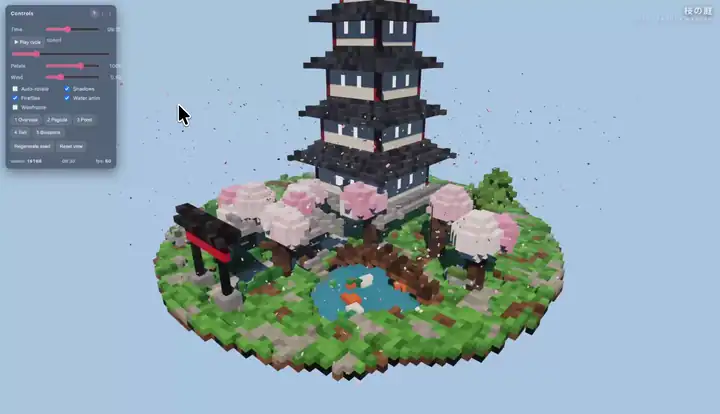

> **[中文化] Strata**
>
> 此项目是 [Niko1221/Strata](https://github.com/Niko1221/Strata) 的中文翻译版本。
> - 原项目 Stars: 17002
> - 主语言: C++
> - 许可证: MIT
> - 翻译日期: 2026-10-08
> - 原始 README: [README_en.md](README_en.md)
>
> 说明：下方 README 正文为**原项目文档的中文翻译**，力求忠于原文；本页顶部的「中文快速上手」为**面向中文用户的补充导读**（非原文内容），目的是让你不用读完整篇 README 就能先把项目跑起来。
>
> 如有翻译不准确之处，欢迎提 Issue 或 PR。

---


## 🚀 中文快速上手（补充导读，非原文）

### 这是什么 / 解决什么问题

Strata 让你在自己的普通 PC 上运行一个 1250 亿参数的大模型（Qwen3.8-Flash-Next），无需服务器。它能聊天、写代码、理解图片，并能与你的应用和编程助手协作，所有数据都不离开你的电脑。它解决的是「想用大模型但不想依赖云端、也不想买服务器」的问题。

### 快速上手（最短路径）

1. **下载并解压**：从 [GitHub 下载 main.zip](https://github.com/Niko1221/Strata/archive/refs/heads/main.zip) 并解压（或使用 `git clone`）。
2. **Windows**：双击 **`START-HERE.bat`**。**Linux**：在 Strata 文件夹中运行 **`./setup.sh`**。
3. 安装程序会问你几个问题（选哪个模型、多大、多少上下文、是否读图），每次按 **Enter** 接受推荐值即可。
4. 它会自动下载模型（约 70 GB）并启动。浏览器会打开 `http://127.0.0.1:8080`。
5. **下次启动**：再次运行 `START-HERE.bat`（或 `./setup.sh`），会直接启动，不会重复下载。关闭窗口即停止模型。

> 也可以用 AI 编程助手自动安装：把 README 中提供的提示文本粘贴给 Claude Code、Cursor、Codex、GitHub Copilot 等即可。

### 环境要求

- **操作系统**：Windows 10 / 11 或 Linux，需最新的 NVIDIA 或 AMD 显卡驱动。
- **显卡**：NVIDIA GeForce RTX 20/30/40/50 系列，或 AMD Radeon RX 7900 XT/XTX、RX 7800 XT/7700 XT、RX 9060 XT、RX 9070/9070 XT、Radeon AI PRO R9700、RX 6800/6900 系列。**需要 12 GB 显存或以上**（8 GB 也能跑，但很慢）。
- **内存**：32 GB 或以上；64 GB 可运行所有尺寸的模型。
- **硬盘**：约 80 GB 可用空间，建议用 SSD（首次启动会快很多）。
- **CPU**：x86-64 且支持 AVX2（原文未说明具体最低型号，仅提到「任何 Intel/AMD 桌面 CPU」）。
- **Python**：3.10 或以上（`START-HERE.bat` 会在缺失时自动安装 Python 3.12）。
- **国内网络提示**：模型从 Hugging Face 下载（约 70 GB），国内用户可能需要更换镜像源或使用加速下载。

### 常见坑与注意事项

- **首次启动会卡顿**：模型启动时 PC 可能 1-3 分钟变慢或无响应（首次最久），因为要加载 35-55 GB 到内存并预留显存。这是正常的，不要关闭窗口。
- **需要大显存**：12 GB 显存是硬性门槛，低于此值虽然能跑但很慢；显存越大速度越快。
- **下载量大且可断点续传**：模型约 70 GB，下载中断后重新运行会从断点继续，不会从头开始。
- **平台限制**：Intel Arc、Strix Halo 等属于实验性支持，需在 Linux 下从源码编译；Docker 方式仅支持 NVIDIA 显卡，且宿主机需 NVIDIA 驱动 >= 580 和 nvidia-container-toolkit。

---


---

<h1 align="center">Strata</h1>

**English** · [简体中文](README.zh-CN.md) · [日本語](README.ja.md) · [Deutsch](README.de.md) · [Français](README.fr.md) · [Español](README.es.md) · [Português](README.pt-BR.md)

<p align="center"><b>在你自己的游戏 PC 上运行 1250 亿参数的 AI 模型</b><br>
NVIDIA 或 AMD 显卡（12 GB 或以上）· Windows 或 Linux · 免费且开源</p>

<p align="center"><a href="https://github.com/Niko1221/Strata/releases/download/v0.1.10/Pagoda.mp4"></a><br>
<sub>一个体素宝塔花园，单次提示词在 RTX 5070 上通过 Strata 运行（IQ3_S，128K 上下文）·
<a href="https://github.com/Niko1221/Strata/releases/download/v0.1.10/Pagoda.mp4">完整视频（49 秒）</a></sub></p>

Strata 在普通 PC 上运行 **[Qwen3.8-Flash-Next](https://huggingface.co/Qwen/Qwen3.8-Flash-Next)**。这是一个
通常需要服务器才能运行的大型智能 AI 模型。它可以聊天、编写代码、读取图片，并与你的应用
和编程智能体协同工作。一切都不会离开你的 PC。

## 它有多快？

我们在两台普通游戏 PC 上进行了测量。一个 token 大约相当于 ¾ 个单词。

- **生成回答：** 回复在简短聊天中出现的速度。每秒 60 个 token 比你阅读的速度还快。
- **读取你的提示词：** 它接收你发送内容的速度（此处为 32K token 的文档、代码或聊天记录）。

<table>
<tr><th>NVIDIA：RTX 5070（12 GB）、Ryzen 5 7600、64 GB RAM</th><th>AMD：RX 9070 XT（16 GB）、Ryzen 9 3900X、47 GB RAM</th></tr>
<tr><td>

| 规格 | 生成回答 | 读取你的提示词 |
| --- | ---: | ---: |
| **Q2_0** | 94 tokens/s | 2,650 tokens/s |
| **IQ2_XS** | 79 tokens/s | 2,090 tokens/s |
| **IQ3_XXS** | 62 tokens/s | 1,750 tokens/s |
| **IQ3_S** | 53 tokens/s | 1,620 tokens/s |
| **Coder** | 55 tokens/s | 2,180 tokens/s |

</td><td>

| 规格 | 生成回答 | 读取你的提示词 |
| --- | ---: | ---: |
| **Q2_0** | 60 tokens/s | 1,160 tokens/s |
| **IQ2_XS** | 52 tokens/s | 1,110 tokens/s |
| **Coder** | 44 tokens/s | 1,420 tokens/s |

</td></tr>
</table>

NVIDIA：Q2_0 使用引擎 0.1.36，其他行使用 0.1.26（4K 回答，32K 提示词）。完整表格见
[DETAILS.md](docs/DETAILS.md#speed-measured)。显存更大的显卡更快：RTX 3090（24 GB）应该能
达到每秒约 100-140 个 token。长聊天和其他显卡：[每个模型的速度](docs/MODELS.md#how-fast-is-each-size)、
[社区测试结果](docs/COMMUNITY_BENCHMARKS.md)。

<p align="center"><a href="https://buymeacoffee.com/strataengine"></a><br>
<sub>Strata 是免费的。如果它在你的 PC 上运行良好，一杯咖啡能让这项工作继续下去。</sub></p>

## 你需要什么

| | |
| --- | --- |
| **显卡** | **NVIDIA** GeForce RTX 20、30、40 或 50 系列，或 **AMD** Radeon RX 7900 XT / XTX、RX 7800 XT / 7700 XT、RX 9060 XT、RX 9070 / 9070 XT、Radeon AI PRO R9700 或 RX 6800 / 6900 系列。需要 **12 GB 或以上显存**。 |
| **内存** | 32 GB 或以上。你的内存决定[哪个模型](#which-model-should-i-pick)能装下。64 GB 可以运行所有规格。 |
| **磁盘** | 约 80 GB 可用空间。尽量使用 SSD：首次启动会快得多。 |
| **系统** | Windows 10 / 11 或 Linux，以及 NVIDIA 或 AMD 的最新显卡驱动。 |

安装程序会设置好其他一切。两块或三块显卡可以共享模型（[多 GPU](docs/MULTI_GPU.md)）。

实验性支持，由社区成员在自己的机器上编写和测试：

- **较旧的显卡**（Tesla P40 / V100、GTX 10、Radeon VII / MI50、RX 6700 XT、RX 5500 XT）：[较旧的 GPU](docs/OLDER_GPUS.md)。
- **Intel Arc**，在 Linux 上从源码构建：[Intel Arc](docs/INTEL_ARC.md)。
- **AMD Ryzen AI Max（Strix Halo）**，在 Linux 上从源码构建：[Strix Halo](docs/STRIX_HALO.md)。
- **不支持 AVX2 的较旧处理器**：可以运行，但很慢。[较旧的 CPU](docs/INSTALL.md#older-cpus-experimental)。

完整列表：[docs/INSTALL.md](docs/INSTALL.md#what-you-need)。

## 安装

### 让你的 AI 来设置

你使用 AI 编程助手（Claude Code、Cursor、Codex、GitHub Copilot……）吗？把下面这段粘贴进去：

```text
Set up Strata on this PC for me: https://github.com/Niko1221/Strata - follow docs/AI_SETUP.md in that repository.
```

它会检查你的显卡、内存和磁盘，并选择适合的模型。然后它会安装并启动它，并告诉你
如何连接你的应用。AI 工具还可以通过其
[MCP 服务器](docs/MCP_SERVER.md)来安装、启动和停止 Strata。

### 或者自己动手

[下载 Strata](https://github.com/Niko1221/Strata/archive/refs/heads/main.zip) 并解压（或 `git clone` 它）。
**Windows：** 双击 **`START-HERE.bat`**。**Linux：** 在 Strata 文件夹中运行 **`./setup.sh`**。

NVIDIA 和 AMD 的步骤相同。安装程序会找到你的显卡并为其设置合适的引擎。它会
问你几个问题：

- 哪个模型以及哪个规格，
- 多少上下文（模型记住多少文本），
- 是否应该读取图片。

每次按 Enter 使用推荐的答案。然后它会下载模型（约 70 GB）并启动它。如果
下载中断，再次运行即可：它会从断点继续。你的浏览器会打开 Strata 应用，地址为
`http://127.0.0.1:8080`。

> **模型启动期间，你的 PC 可能会变慢或停止响应 1-3 分钟**（首次时间最长）。
> Strata 会将 35-55 GB 加载到你的内存中，并为显卡锁定其中一部分。这是正常的。请等待，不要
> 关闭窗口。窗口会显示 Strata 正在做什么。

**下次**，再次运行 `START-HERE.bat`（或 `./setup.sh`）。它会立即启动，不会重复下载任何内容。关闭
其窗口即可停止模型。`UPDATE.bat`（`./update.sh`）会更新 Strata 而不启动它。更新、Docker、
多块显卡、文件存放位置以及所有选项：[docs/INSTALL.md](docs/INSTALL.md)。

## 我应该选择哪个模型？

安装程序会根据你的内存推荐一个。同一个模型有多种规格，压缩程度不同。较小的
规格更快。较大的规格更聪明一些。

| 你的内存 | 选择 | 原因 |
| --- | --- | --- |
| **32 GB** | **Coder** | 它能装进 32 GB，而且专为代码而做（使用 24 GB 显卡时，Q2_0 和 IQ2_XS 也能运行） |
| **48 GB** | **IQ2_XS**（或 Q2_0，最快） | 更大的规格装不下 |
| **64 GB** | **IQ2_XS**（推荐），或 IQ3_XXS / IQ3_S | 所有规格都能装下；IQ3_S 最好也最慢 |
| **96 GB 或以上** | **IQ3_S**，或 Unsloth 的 UD-IQ4_XS（约 4-bit） | 有空间容纳最大规格，同时还能打开其他所有程序 |

- **[Coder](docs/MODELS.md#coder)：** 一个移除了半数专家的编程版本。它达到了完整
  模型 SWE-bench Verified 分数的 91%（由其作者测量），并能装进 32 GB 内存。它在代码之外较弱，
  包括中文和其他 CJK 文本（#438）。对于这些，请选择 Q2_0、IQ2_XS 或 IQ3_S，它们保留了每个专家。
- **[Swift 1.5](docs/MODELS.md#swift-15)：** 一个微调版本，在回答前思考的时间短得多。你
  能更快得到答案，质量大致相同。
- **[Unsloth UD-IQ4_XS](docs/MODELS.md#unsloth-ud-iq4_xs)：** Unsloth 的约 4-bit 版本，质量介于 IQ3_S 和
  UD-Q4_K_XL 之间。下载量 94 GB。内存少于约 80 GB 时，Strata 在回答时会从 SSD 读取其中一部分，
  因此在那里会更慢（NVMe SSD 会有帮助）。
- **[Unsloth UD-Q4_K_XL](docs/MODELS.md#unsloth-ud-q4_k_xl-experimental)**（实验性）：最接近完整
  模型。但 Strata 在回答时会从 SSD 读取其中大部分，因此在 64 GB PC 上它只能生成 7-8.5 tokens/s。
- **[OrcaRouter 的无审查 IQ3_XXS](docs/MODELS.md#orcarouter-uncensored-iq3_xxs)：** 你需要手动设置它。它
  不在安装程序的菜单中。

规格、下载量以及什么适合哪里：[docs/MODELS.md](docs/MODELS.md)。以后要添加另一个模型，请运行
`SETUP.bat`（Linux：`./setup.sh --setup`）。

## 使用它

<p align="center"><br>
<sub>Strata 应用的 <b>Monitor</b>（左侧），同时一个编程智能体正在编写视频中的宝塔花园（右侧）</sub></p>

- **在浏览器中：** 打开 `http://127.0.0.1:8080`。它有 **Chat**、模型和你的
  GPU/CPU/RAM 的实时 **Monitor**，以及包含设置和地址的 **About**。
- **你的应用和编程智能体：** 添加一个"OpenAI 兼容"提供程序，基础 URL 为
  **`http://127.0.0.1:8080/v1`**。任何 API 密钥和任何模型名称都可以使用。
  - 使用 Anthropic API 的应用：`http://127.0.0.1:8080/v1/messages`（Claude Code：
    `ANTHROPIC_BASE_URL=http://127.0.0.1:8080`）。
  - Codex CLI 和其他使用 OpenAI Responses API 的应用：`/v1/responses`
    （[设置](docs/DETAILS.md#the-responses-api-and-codex-cli)）。
- **思考：** 在聊天菜单或你应用的"推理强度"中选择 **关闭、低、中或高**。关闭最快。
  高最适合难题。
- **图片：** 在设置中对"图片？"回答是。然后在聊天中点击 **Picture**，或在你的应用中附加图片。
  AMD 显卡在 Linux 上通过处理器读取图片；在 Windows 上目前还不能。
- **从你的手机或另一台 PC：** `START-HERE.bat --setup --host 0.0.0.0 --api-key <secret>`。务必设置密钥。
- **一次一个请求：** 默认情况下 Strata 一次回答一个请求，其他请求等待。要同时回答多个请求，
  设置 `"parallel": 2`（[BATCHING.md](docs/BATCHING.md)）。在 12 GB 显卡上这会使每个回答变慢。
- **长提示词：** Strata 会完整读取聊天的第一条消息，大约每 30,000 个 token 需要 1 分钟。后续
  消息在几秒内开始。

更多：[你的聊天记录存储在哪里](docs/INSTALL.md#where-things-are-stored)、[API](docs/DETAILS.md#using-it)。

## 出问题了？

- **Strata 首次启动时我的 PC 卡住了。** 在加载模型期间这是正常的。请等待，不要关闭
  窗口。10 分钟后仍然卡住？重启 PC，关闭其他程序再试，或选择较小的规格。
- **它在下载或安装时停止了。** 再次运行 `START-HERE.bat`（或 `./setup.sh`）。它会从
  停止的地方继续。
- **它非常慢，磁盘指示灯不停闪烁，或者它显示"引擎意外停止"。** 你的 PC
  没有足够的可用内存。关闭其他程序（浏览器占用很多），或选择较小的规格（Q2_0 或 IQ2_XS）。
- **它显示端口 8080 已被占用。** Strata 已经在运行。找找它的窗口。

更多问题及其解决方法：[docs/TROUBLESHOOTING.md](docs/TROUBLESHOOTING.md)。仍然卡住？提交一个
[Issue](https://github.com/Niko1221/Strata/issues) 并附上 Strata 文件夹中的 `strata-<model>.log`。发现了
安全问题？请私下报告：[SECURITY.md](SECURITY.md)。

## 它是如何工作的？

像这样的模型通常运行在拥有数百 GB 显存的服务器上。你的显卡只有
12-24 GB。Strata 通过**在整个 PC 上分担工作**来让模型装下。想象一个厨房：你一直
使用的东西放在台面上，其余的在储藏室里等待。

<p align="center"></p>

- **模型是一个由 24,576 个小专家组成的团队。** 每个词只需要其中 10 个。
- **你的显卡**保留使用最频繁的几千个专家。**你的内存**容纳所有专家，
  **你的处理器**同时处理其余的。**你的 SSD**保存一张大型查找表。

<p align="center"></p>

- **先猜，再检查：** 一个小助手猜测接下来的几个词。大模型一次性检查它们全部。你得到
  相同的答案，但快 1.6-1.8 倍。
- **长文本以大块读取**（每次最多 8,192 个 token），速度超过每秒 1,000 个 token。

更详细的解释：[docs/HOW_IT_WORKS.md](docs/HOW_IT_WORKS.md)。每个部分及其数据：
[详细信息](docs/DETAILS.md#how-it-works)和[论文](docs/paper/Strata-Paper.pdf)。

## 致谢和许可

该模型是 Qwen 团队的 [Qwen3.8-Flash-Next](https://huggingface.co/Qwen/Qwen3.8-Flash-Next)。它由
[ISTA-DASLab](https://huggingface.co/ISTA-DASLab/Qwen3.8-Flash-Next-GSQ-RCO-GGUF)、UkisAI（Swift 1.5）
和 Unsloth 压缩。Strata 使用了 [llama.cpp / ggml](https://github.com/ggml-org/llama.cpp) 的部分内容。所有致谢：
[docs/HOW_IT_WORKS.md](docs/HOW_IT_WORKS.md#credits)。Strata 是在 [MIT 许可证](LICENSE)下的开源项目。少数
部分和每个模型都有自己的许可证（[哪些](docs/HOW_IT_WORKS.md#license)）。

## 支持 Strata

Strata 是免费且开源的。如果它对你有用，你可以支持它的开发：

<p align="center"><a href="https://buymeacoffee.com/strataengine"></a></p>